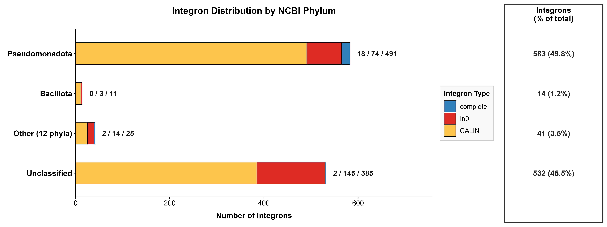
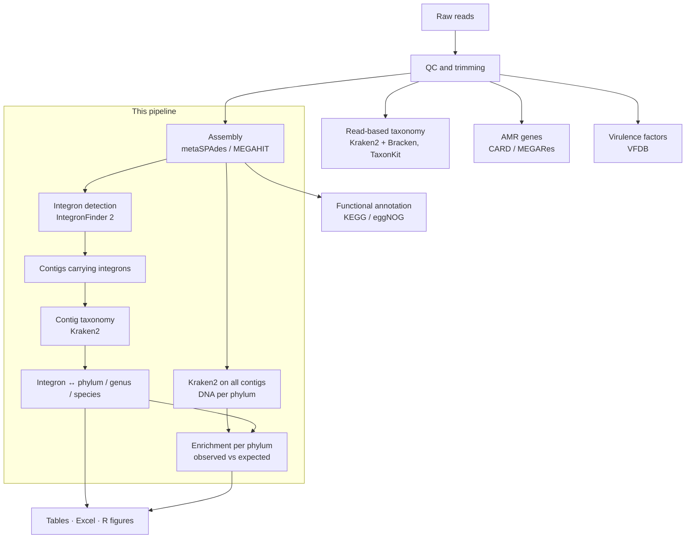

# Integron–Phylum Pipeline

**Link every integron in a metagenome to the bacterial phylum (and genus) that carries it, with one command.**

`Integron_Phylum_Pipeline.sh` connects **IntegronFinder 2** (integron detection) with **Kraken2** (taxonomy of the contig carrying each integron). It produces analysis-ready tables, an Excel workbook and publication-quality R figures. It can also test which phyla carry more or fewer integrons than expected from their abundance.


*Example output: integrons from 30 metagenomes, assigned to the phylum of their own contig (labels: complete / In0 / CALIN). Data unpublished; shown in aggregate only.*

---

## Why this pipeline?

A typical metagenomic study of antimicrobial resistance (AMR) runs several analyses side by side:

| Question | Typical tools |
|---|---|
| Who is in the community? | Kraken2 + Bracken, TaxonKit |
| What can the community do? | assembly (metaSPAdes / MEGAHIT), gene prediction, KEGG / eggNOG functional annotation |
| Which resistance genes are present? | CARD, MEGARes |
| Which virulence factors? | VFDB |
| Which integrons and gene cassettes? | IntegronFinder 2 (+ functional annotation of cassettes) |

Each of these is usually reported **separately**. A study can say "the samples contain >1,000 integrons" and "the community is dominated by Pseudomonadota" without ever answering the question that links them: **which bacteria carry the integrons?**

That link matters. Integrons capture, express and spread gene cassettes, many of them antibiotic resistance genes, through horizontal gene transfer. Knowing their **hosts** shows which bacterial groups act as reservoirs and vehicles of resistance. Surveillance and One Health work need exactly this information.

The idea comes from **Néron et al. (2022), IntegronFinder 2.0** ([*Microorganisms* 10:700](https://doi.org/10.3390/microorganisms10040700)). Their Fig. 2D shows how integrons are distributed across bacterial phyla, but it uses complete RefSeq genomes, where the host of every replicon is already known. In metagenomes the host is unknown:

- IntegronFinder reports *where* an integron is (contig ID), not *which organism* the contig belongs to.
- No ready-made workflow goes from metagenomic contigs to an integron-by-phylum table and figure.
- A common shortcut, giving every integron in a sample that sample's dominant taxon, can be badly misleading. In our data it attributed 268 integrons to a phylum that contig-level classification did not support at all.

This pipeline fills that gap. **Every integron gets the taxonomy of its own contig.** The whole process is reproducible, from assembled contigs to figures. With `-a` it also asks the question behind the original figure: **does a phylum carry more (or fewer) integrons than expected from its share of the metagenome?** Raw counts cannot answer this, because an abundant phylum will always show many integrons.

## Where it fits in a metagenomic workflow



## What it does

| Step | Tool | Output |
|---|---|---|
| 1. Detect integrons in every sample (parallel; finished samples are skipped) | IntegronFinder 2 | `IntegronFinder/<sample>/` |
| 2. One row per integron: type, number of attC sites, number of proteins | awk | `Integron_per_contig_raw.tsv` |
| 3. Extract only integron-carrying contigs; classify them in one Kraken2 run | Kraken2 | `Kraken2/`, `contig_taxonomy.tsv` |
| 4. Phylum / genus / species for each integron (lineage parsed from the Kraken2 report) | awk | `Integron_Phylum_Association.tsv` |
| 5. Summaries per sample (including samples with zero integrons), per phylum, per genus | awk | `Integron_counts_per_*.tsv` |
| 6. Excel workbook (4 sheets) | pandas | `Integron_Phylum_Association.xlsx` |
| 7. Phylum distribution figure (style of Néron et al. Fig. 2D, plus "samples with integrons") | R / ggplot2 | `Fig2D_Integron_Phylum_Distribution_600DPI.png` |
| 8. *Optional `-a`:* Kraken2 on **all** contigs → DNA per phylum → **integron enrichment per phylum** (exact binomial test, Benjamini–Hochberg correction) | Kraken2 + R | `Integron_Phylum_Enrichment_results.csv`, `Fig_Integron_Phylum_Enrichment_600DPI.png` |

## Installation

```bash
git clone https://github.com/HadiRownok/Integron-Phylum-Pipeline.git
cd Integron-Phylum-Pipeline
chmod +x scripts/Integron_Phylum_Pipeline.sh

conda env create -f envs/integronfinder.yml   # IntegronFinder 2
conda env create -f envs/kraken2.yml          # Kraken2
conda env create -f envs/plotenv.yml          # Python + R for tables and figures

# Kraken2 database, e.g. Standard-16 (~11 GB): https://benlangmead.github.io/aws-indexes/k2
mkdir -p ~/db/kraken2_std16 && cd ~/db/kraken2_std16
wget https://genome-idx.s3.amazonaws.com/kraken/k2_standard_16_GB_20261022.tar.gz
tar -xzf k2_standard_16_GB_20261022.tar.gz
```

## Usage

```bash
conda activate integronF
export PATH=~/miniconda3/envs/plotenv/bin:$PATH      # Excel + figures on the server

scripts/Integron_Phylum_Pipeline.sh -k ~/db/kraken2_std16 -e kraken2 -a *_contigs.fasta
```

| Option | Meaning | Default |
|---|---|---|
| `-k DIR` | Kraken2 database (or set `KRAKEN2_DB`) | required |
| `-e ENV` | conda env containing kraken2, if not the active one | active env |
| `-t FILE` | manual taxonomy table (`sample  Phylum  Organism_Name`) instead of Kraken2 | – |
| `-o DIR` | output folder | `Integron_Phylum_results` |
| `-r DIR` | reuse existing IntegronFinder results | `OUT/IntegronFinder` |
| `-c N` | CPUs per IntegronFinder run / Kraken2 threads | 8 |
| `-j N` | samples processed in parallel | 4 |
| `-a` | also run the integron–phylum enrichment analysis | off |

Sample names are taken from file names: `sample1_contigs.fasta` → `sample1`.
Re-running is safe: IntegronFinder and Kraken2 steps that already finished are skipped.

## Figures in R

All R scripts read the pipeline output. Set the path at the top of each script, then run it in RStudio, or call it with `Rscript`.

| Script | Figure |
|---|---|
| `scripts/Integron_Phylum_Figure.R` | Integron distribution by phylum, with "% of integrons" and "samples with integrons" boxes (shown above) |
| `scripts/Integron_Phylum_Enrichment.R` | Observed vs expected integrons per phylum (forest plot) + DNA share vs integron share |
| `scripts/Integron_Overview_Figures.R` | 5-panel overview: load per sample, sample × phylum heatmap, top genera, cassette array size, contig length vs classification |
| `scripts/Integron_Infographic.R` | Summary infographic: key numbers, phylum donut, top host genera |

```bash
Rscript scripts/Integron_Phylum_Figure.R Integron_Phylum_results/Integron_Phylum_Association.xlsx
Rscript scripts/Integron_Phylum_Enrichment.R Integron_Phylum_results/
```

Sample IDs are anonymised in the overview figures by default (`anonymize <- TRUE`).

## Repository structure

```
Integron-Phylum-Pipeline/
├── scripts/
│   ├── Integron_Phylum_Pipeline.sh     # the pipeline (steps 1–8)
│   ├── Integron_Phylum_Figure.R        # main phylum figure
│   ├── Integron_Phylum_Enrichment.R    # enrichment statistics + figure
│   ├── Integron_Overview_Figures.R     # 5-panel overview
│   └── Integron_Infographic.R          # summary infographic
├── envs/                               # conda environments
├── example/sample_taxonomy_template.tsv
├── docs/figures/                       # example output
├── LICENSE
└── README.md
```

## Output columns (`Integron_Phylum_Association.tsv`)

`sample`, `replicon_name` (contig), `integron_in_replicon_id`, `integron_type` (complete / In0 / CALIN), `#attC`, `#protein`, `Phylum`, `Organism_Name` (genus), `Species`, `taxid`, `kraken_name`

## Notes and limitations

- **Short contigs are often unclassified.** In our data, unclassified integron contigs were about half the length of classified ones (median ~0.8 kb vs ~1.5 kb). A larger Kraken2 database or protein-level classification (e.g. CAT/MMseqs2) can reduce this.
- Integrons and cassettes move between bacteria by horizontal gene transfer. The taxonomy reported is that of the **contig** carrying the integron, which is the best available proxy for the host in a metagenome.
- The enrichment test uses classified DNA only. The fraction of classified contigs varies between samples and databases, and should be reported alongside the results.
- In0 elements have no attC sites by definition, and CALINs require at least two, so attC counts are shown as distributions without a statistical test between types.

## Data availability

The pipeline and code are public. **The metagenomic data used to develop and test it are unpublished and confidential.** No sequences, sample-level data or sample identifiers are included in this repository; the example figure shows aggregate counts only.

## Citation

If you use this pipeline, please cite the tools it builds on:

- Néron B., Littner E., Haudiquet M., Perrin A., Cury J., Rocha E.P.C. (2022). IntegronFinder 2.0: identification and analysis of integrons across Bacteria, with a focus on antibiotic resistance in *Klebsiella*. *Microorganisms* 10(4):700. https://doi.org/10.3390/microorganisms10040700
- Wood D.E., Lu J., Langmead B. (2019). Improved metagenomic analysis with Kraken 2. *Genome Biology* 20:257. https://doi.org/10.1186/s13059-019-1891-0

## License

MIT
